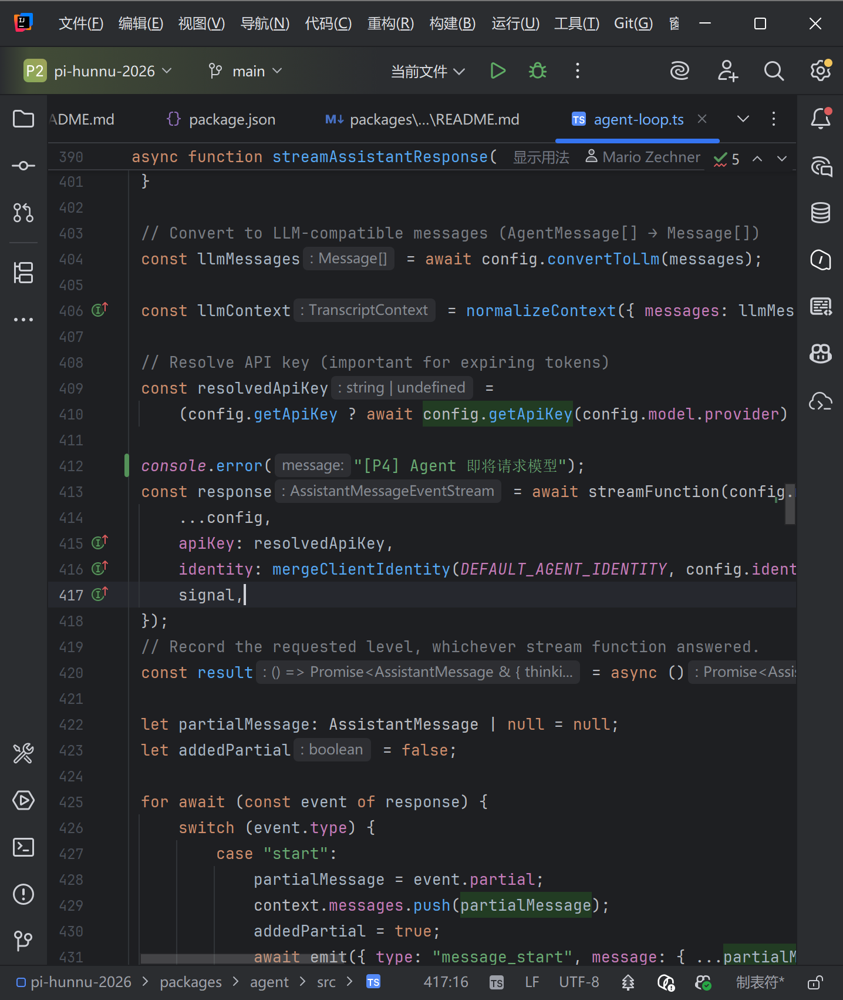
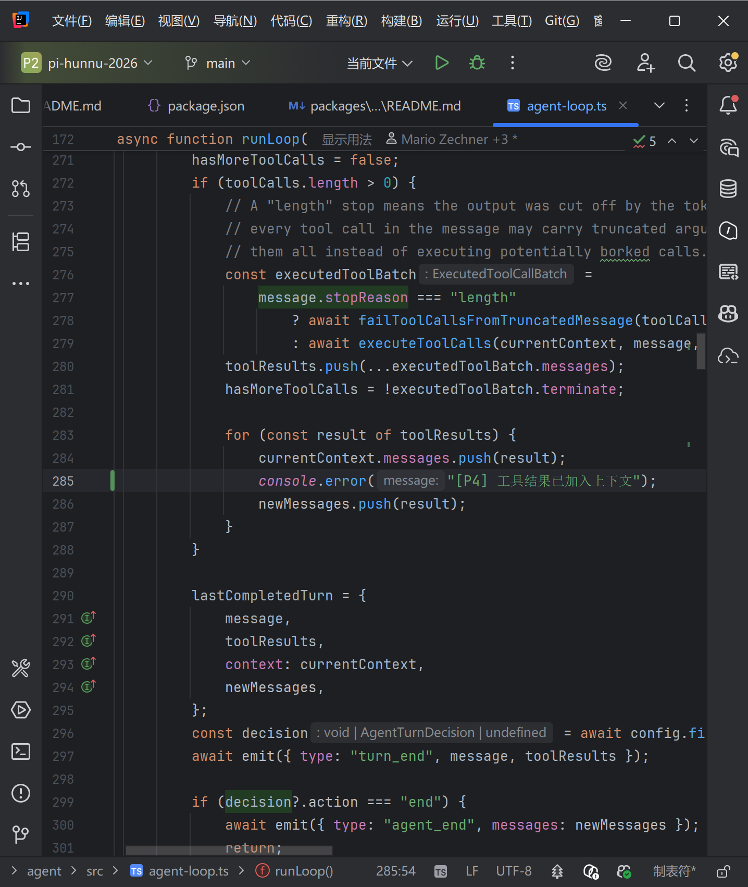
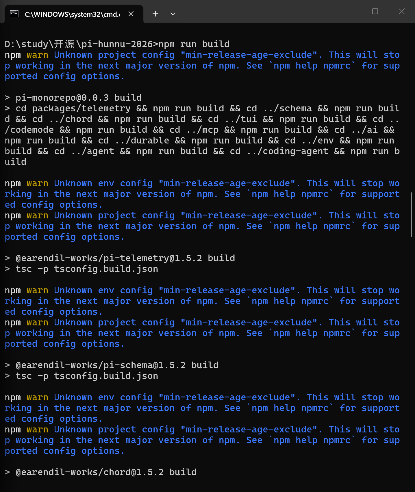
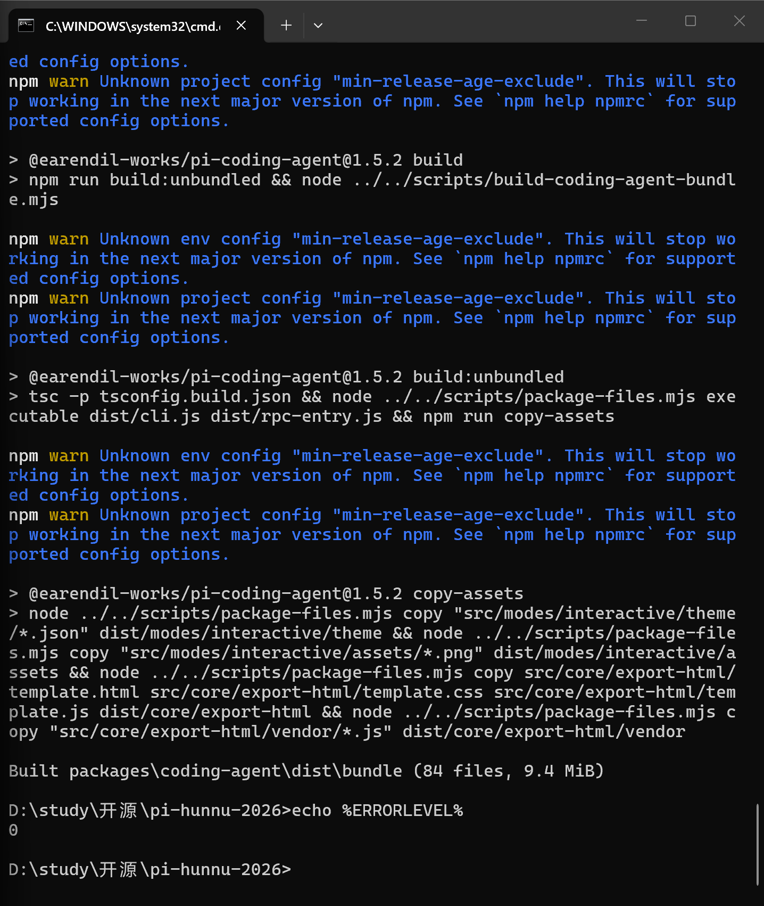
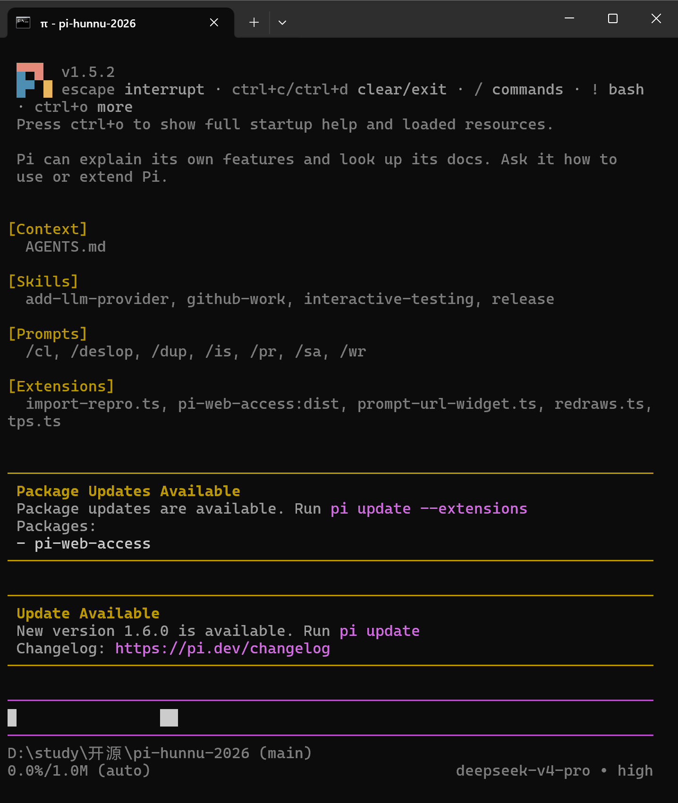
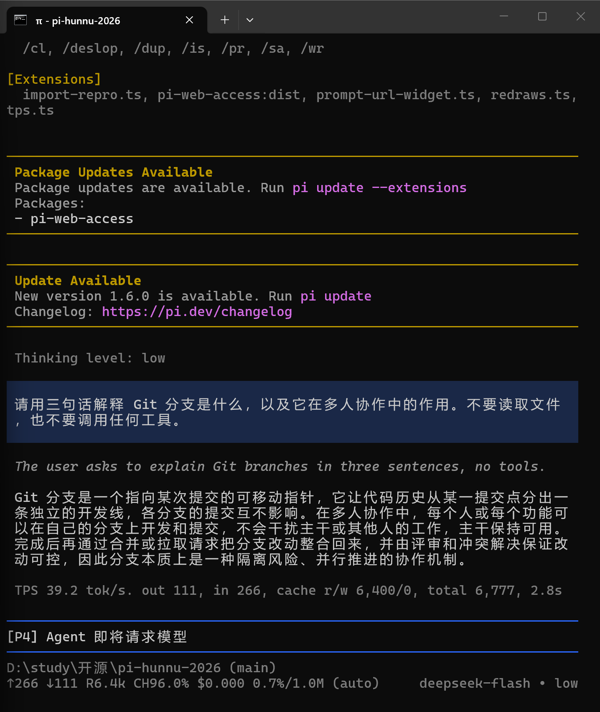
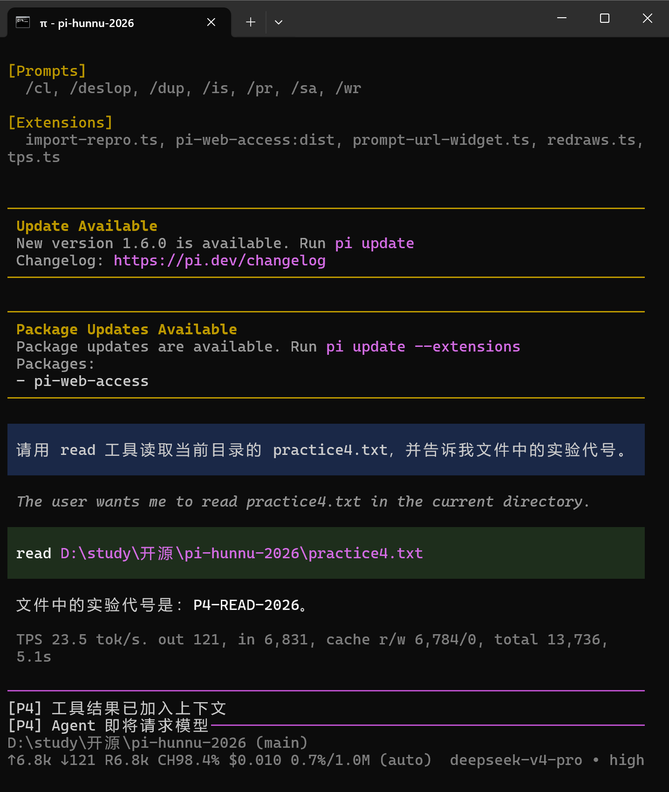

# 实践课 4：Pi Agent 的模型调用与运行流程

- 姓名：阳凌杰
- 小组仓库：[superheror/pi-hunnu-2026](https://github.com/superheror/pi-hunnu-2026)
- 本地实验目录：`D:\study\开源\pi-hunnu-2026`
- 实验所用基础提交：`c3cc91632d0a1950fb122605b190233f2aa0006e`；实验时在本地修改了源码。

## 一、实验目的

按[教师作业要求](https://github.com/hunnuOpenSourceSoftware2026/assignments/blob/main/practice/04-Pi-Agent-run.md)，在实践课 3 的 Pi 项目中增加两条观察日志，重新构建，并比较直接问答与读取文件时的 Agent 循环。实验源码位于小组项目 `pi-hunnu-2026`，Pi 交互界面版本为 v1.5.2。本文只提交报告、截图和测试文本，不包含完整源码或构建依赖。

## 二、源码修改

文件：`packages/agent/src/agent-loop.ts`。

1. 在 `streamAssistantResponse` 中，紧靠 `await streamFunction(...)` 之前插入日志（截图中的第 412 行）：

   ```ts
   console.error("[P4] Agent 即将请求模型");
   const response = await streamFunction(config.model, llmContext, {
   ```

   这表示 Agent 即将把当前上下文交给模型调用函数。

   

2. 在 `runLoop` 的 `for (const result of toolResults)` 循环内，紧靠 `currentContext.messages.push(result)` 之后插入日志（截图中的第 285 行）：

   ```ts
   for (const result of toolResults) {
       currentContext.messages.push(result);
       console.error("[P4] 工具结果已加入上下文");
       newMessages.push(result);
   }
   ```

   每条工具结果写入上下文时打印一次。

   

## 三、构建与启动

在小组项目根目录运行 `npm run build`。S3a 记录命令及构建过程；S3b 显示生成 `packages\coding-agent\dist\bundle`（84 个文件，9.4 MiB），命令返回提示符，随后执行 `echo %ERRORLEVEL%` 得到 `0`。截图使用的是 Windows CMD，故以 `%ERRORLEVEL%` 检查退出码。构建期间有 npm 配置警告，但最终构建成功。





随后启动编译后的 Pi，v1.5.2 成功进入交互界面。



此前一次在线构建因连接 `models.dev` 超时失败；重新执行 `npm run build` 后成功。这里以最终成功构建的 S3a、S3b 为准。

## 四、两次会话的实际观察

### A：直接问答

- **实际输入指令**：“请用三句话解释 Git 分支是什么，以及它在多人协作中的作用。不要读取文件，也不要调用任何工具。”
- **是否调用工具**：截图中没有 `read`、`bash` 等工具调用记录；本次未观察到工具调用。
- **按出现顺序记录的 `[P4]` 日志**：`[P4] Agent 即将请求模型`（1 条）。没有观察到 `[P4] 工具结果已加入上下文`。
- **最终回复**：Pi 用三句话说明 Git 分支是指向某次提交的可移动指针，开发者可在各自分支上工作，再通过合并或拉取请求整合改动。
- **模型调用轮次**：记录到 1 条“即将请求模型”日志，对应 1 轮模型调用；模型直接生成回答，不需要工具结果回填后的下一轮调用。

S5 中，界面把日志显示在回答下方；日志的插入位置在 `streamFunction` 前，因此执行含义仍是先到达模型请求位置，再获得回答。



### B：读取文件

- **实际输入指令**：“请用 read 工具读取当前目录的 practice4.txt，并告诉我文件中的实验代号。”指令没有提供代号本身。
- **是否调用工具**：是。S6 中有 `read D:\study\开源\pi-hunnu-2026\practice4.txt` 的工具记录。
- **截图中按出现顺序可见的 `[P4]` 日志**：① `[P4] 工具结果已加入上下文`；② `[P4] Agent 即将请求模型`。首次模型请求日志不在 S6 的取景范围内。结合 `read` 工具调用和 S1 所示代码位置，完整执行过程应先有一次模型请求，由模型提出读取文件，再发生截图可见的两条日志；这里将可见日志与流程推断明确区分。
- **最终回复**：“文件中的实验代号是：P4-READ-2026。”与文件内容一致。
- **模型调用轮次**：从执行路径判断为 2 轮。第 1 轮让模型决定调用 `read`；本地工具执行并将结果写入上下文后，第 2 轮把读取结果交给模型，生成最终回答。S6 直接显示的是第 2 轮之前的请求日志，并未单独拍到第 1 轮日志。

交互界面可能交错刷新标准错误输出和回答内容，因此截图中的视觉位置不必然等于严格执行时序；判断顺序还需要结合日志在源码中的插入位置。



`practice4.txt` 的实验代号只存在于文件中，用户指令没有提前透露；所提交的[测试文本](practice4.txt)与截图中的回复一致。

## 五、运行流程分析

```text
用户输入 → coding-agent（交互界面、提供本地 read 工具）
                 │
                 ▼
             agent（循环与上下文）
                 │ 第 1 轮：请求模型
                 ▼
             ai（模型调用接口） ──────► 远程模型服务
                 ▲                         │
                 └──── 模型回复或工具调用 ───┘
                 │
     A：直接回复 ─┴─→ coding-agent 显示答案
                 │
     B：模型要求 read
                 ▼
       agent 调度 coding-agent 的本地 read 工具读取 practice4.txt
                 │ 工具返回文件内容
                 ▼
       agent 将工具结果写入 currentContext.messages
                 │ 第 2 轮：携带新增工具结果
                 ▼
       ai ──► 远程模型服务 ──► 最终答案 ──► coding-agent 显示
```

**谁实际读了文件？** 是由 `agent` 调度的本地 `read` 工具读取 `practice4.txt`。远程模型服务返回工具调用意图，本身不直接访问本机文件。

**下一轮模型请求多带了什么？** `read` 返回的文件内容被包装成工具结果消息，加入 `currentContext.messages`。下一轮请求传递的上下文因此增加这条工具结果，包含实验代号 `P4-READ-2026`。模型依据新增内容作答。A 没有工具结果消息，所以没有这一步，也没有由读文件触发的第 2 轮请求。

